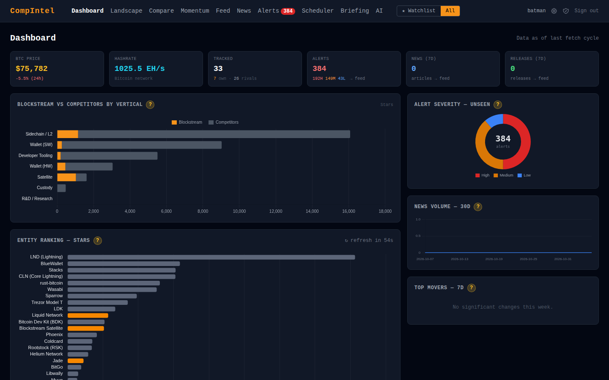
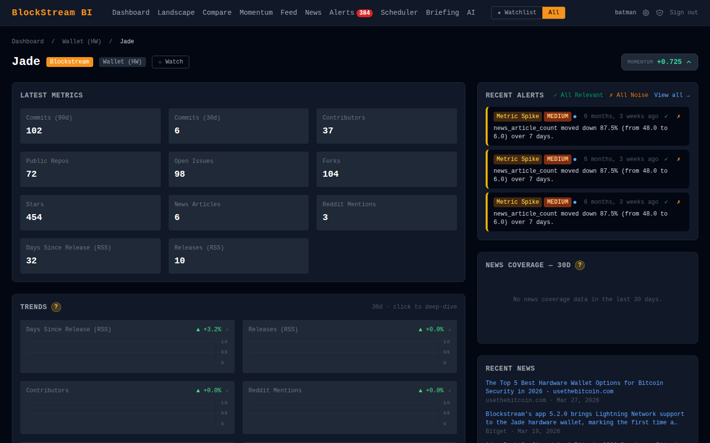
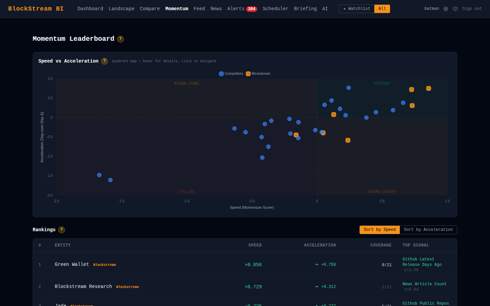
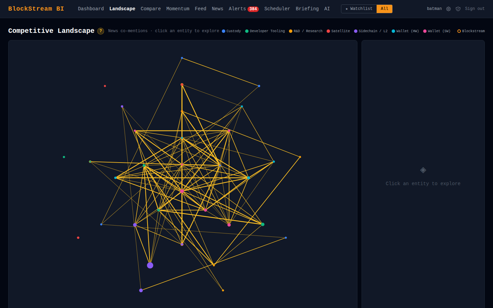

# Competitive Intelligence Dashboard

[](https://github.com/CarloCogni/Competitive-Intelligence-Platform/actions/workflows/ci.yml) [](LICENSE)

An open-source competitive intelligence dashboard that aggregates public signals (GitHub metrics, news, app store data) for a set of tracked organisations and their competitors. Pre-loaded with Blockstream and its competitors across seven product verticals.

---

## Screenshots






---

## What it does

- **GitHub metrics** — stars, forks, open issues, public repos, contributors, commit frequency (30/90d), days since last release
- **News feed** — Google News RSS articles tagged to tracked entities, deduplicated by URL
- **News Intelligence** — LLM-enriched news with sentiment classification, signal type detection, strategic summaries, and key quote extraction. Plotly sentiment heatmap, breakdown stats, on-demand executive takeaways. Ollama-only by default to control API costs
- **App Store metrics** — iOS rating and review count via iTunes Search API
- **Play Store metrics** — Android rating and review count via google-play-scraper
- **Twitter/X metrics** — mention count and engagement via Twitter v2 API
- **Reddit metrics** — mention count via Reddit public API
- **Changelog tracking** — GitHub releases.atom RSS feed, release detection
- **Delta detection** — fires alerts when any metric changes beyond a configurable threshold (static or dynamic via Isolation Forest)
- **Competitor candidate detection** — automatically surfaces untracked entities from news article titles
- **AI briefings** — weekly intelligence briefings via Ollama (local) or Groq (cloud)
- **Dashboard** — sortable entity overview, vertical drill-down with breadcrumbs, head-to-head comparison, unified feed, news intelligence, alerts, competitor candidates

All entity names and API identifiers are loaded from `entities.json` — swap in your own organisation's data and deploy your own instance.

---

## Stack

| Layer | Technology |
|---|---|
| Web framework | Django 6.x |
| Database | SQLite (zero setup) |
| Scheduler | APScheduler via django-apscheduler |
| Dynamic UI | HTMX 1.9, Alpine.js 3.x |
| Styling | Tailwind CSS (Play CDN) |
| Charts | Chart.js 4.x, Plotly.js 2.x (CDN) |
| Package manager | uv |

---

## Quick start

**Prerequisites:** Python 3.13+, [uv](https://docs.astral.sh/uv/)

```bash
git clone https://github.com/CarloCogni/Competitive-Intelligence-Platform.git
cd Competitive-Intelligence-Platform
uv sync
uv run python src/manage.py migrate
uv run python src/manage.py seed       # loads 7 verticals + 31 entities
uv run python src/manage.py seed_demo  # creates demo user + sample data
uv run python src/manage.py runserver
```

Open http://localhost:8000 — the overview page loads immediately.

**Want to see it with real history?** The dashboards become meaningful after days of data collection. A pre-populated demo database is attached to the [latest Release](https://github.com/CarloCogni/Competitive-Intelligence-Platform/releases/latest): download `db.sqlite3.zip`, unzip it into `src/`, then run `migrate` and `runserver`. Log in with `batman` / `the hero we deserve`.

> **Warning:** the demo superuser's password is public. Use `seed_demo` and the demo database for local evaluation only — never on an internet-facing deployment. For a real deployment, create your own admin with `uv run python src/manage.py createsuperuser`.

---

## Running fetchers

Fetchers collect live data from GitHub, Google News, the App Store, Play Store, Twitter/X, Reddit, and changelog RSS feeds.

**Manually (Django shell):**
```bash
uv run python src/manage.py shell
```
```python
from core.models import Entity
from fetchers.github import GithubFetcher

entity = Entity.objects.get(slug="green-wallet")
GithubFetcher(entity).run()
```

**On a schedule (APScheduler):**
```bash
# Edit .env: set RUN_SCHEDULER=true
uv run python src/manage.py runserver
# GitHub 24h, News 2h, App Store 12h, Play Store 12h, Twitter 1h, Reddit 2h, Changelog 12h
```

**Optional — increase GitHub API rate limit:**
```
# In .env:
GITHUB_TOKEN=ghp_your_token_here
```
Without a token: 60 requests/hour. With token: 5,000 requests/hour.

---

## Running tests

```bash
uv run pytest src/ -v
```

All external API calls are mocked. No network access required.

**Coverage:** 532 tests, 90% line coverage (target: 90%).

```bash
uv run pytest src/ --cov=src --cov-report=term-missing   # terminal report
uv run pytest src/ --cov=src --cov-report=html            # HTML report at htmlcov/
```

See [docs/coverage.md](docs/coverage.md) for the full per-module breakdown.

---

## Project structure

```
src/
├── manage.py
├── entities.json              # Config: all tracked organisations
├── config/                    # Django settings, URLs
├── core/                      # Entity + Vertical models, seed command
├── fetchers/                  # Layer 1: GitHub, News, App Store, Play Store, Twitter, Reddit, Changelog
├── metrics/                   # Layer 2: MetricSnapshot, Metric, Alert, NewsItem, delta detection, news enrichment
├── scheduler/                 # APScheduler wiring
└── dashboard/                 # Layer 3: views, templates, HTMX partials
```

---

## Adding a new organisation

Edit `src/entities.json`:

```json
{
  "verticals": [...],
  "entities": [
    {
      "name": "My Org",
      "slug": "my-org",
      "vertical": "developer-tooling",
      "is_primary": false,
      "github_org": "my-github-org",
      "github_repo": "my-main-repo",
      "app_store_id": "",
      "news_keywords": ["My Org", "my product name"]
    }
  ]
}
```

Then re-run `python manage.py seed` — it is idempotent and will only add new rows.

### Tracking your own organisation

Entities with `"is_primary": true` are *your* products; everything else is a competitor. Set your organisation's name in `.env` — it is used in dashboard labels ("<name> vs Competitors") and in the LLM prompts for briefings and competitor detection:

```bash
PRIMARY_ORG_NAME=Acme
PRIMARY_ORG_DESCRIPTION=a developer-tools company
```

Both default to the bundled Blockstream demo dataset.

---

## Out-of-scope features

See [SPEC.md](SPEC.md) for features not built in this release, including:
- CoinGecko / Mempool.space integration
- Job changes tracking
- React frontend migration path

---

## License

Copyright (C) 2026 Carlo Cogni

Licensed under the GNU Affero General Public License v3.0 — see [LICENSE](LICENSE).

Data sourced from public APIs. For informational purposes only.
